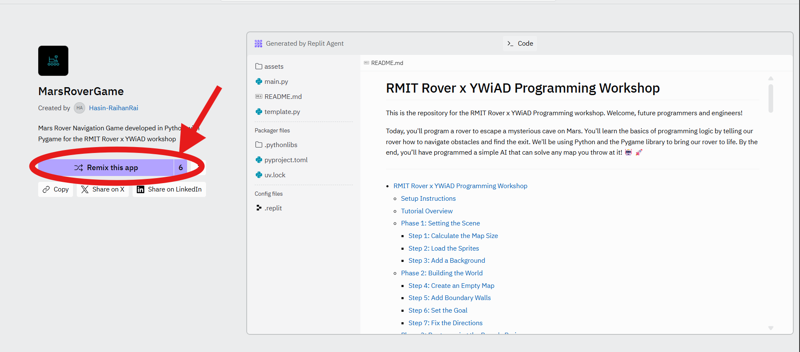
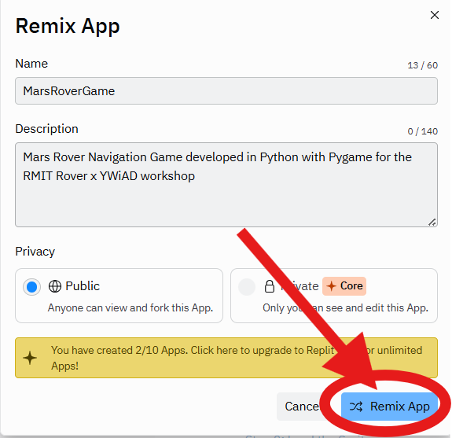
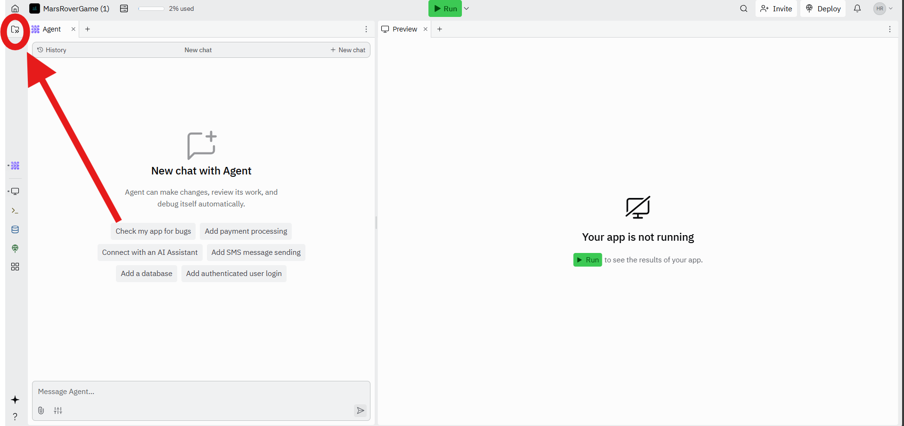
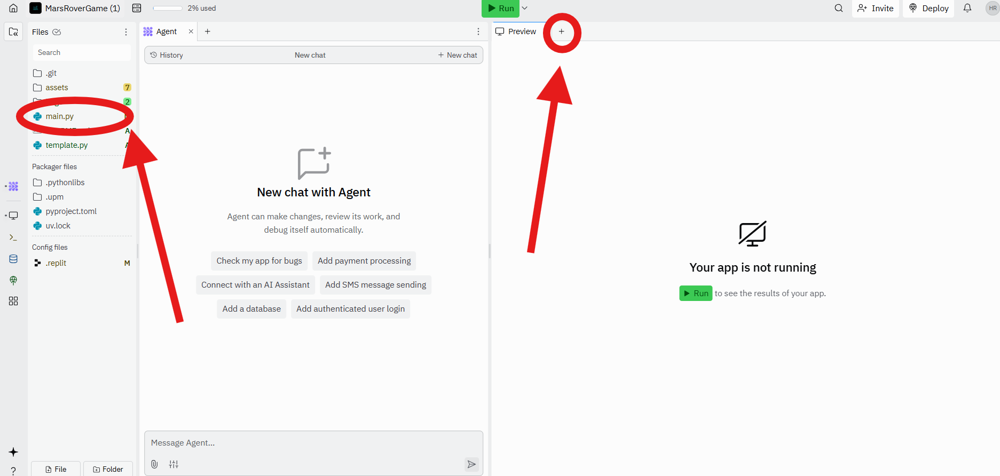
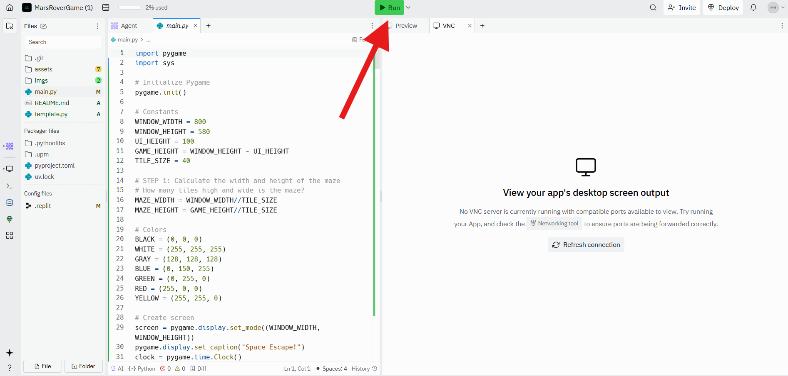

# RMIT Rover x YWiAD Programming Workshop

This is the repository for the RMIT Rover x YWiAD Programming workshop. Welcome, future programmers and engineers!

Today, you'll program a rover to escape a mysterious cave on Mars. You'll learn the basics of programming logic by telling our rover how to navigate obstacles and find the exit. We'll be using Python and the Pygame library to bring our rover to life. By the end, you’ll have programmed a simple AI that can solve any map you throw at it! 🤖 🚀

---
- [RMIT Rover x YWiAD Programming Workshop](#mars-rover-rescue-workshop)
  - [Setup Instructions](#setup-instructions)
  - [Tutorial Overview](#tutorial-overview)
  - [Phase 1: Setting the Scene](#phase-1-setting-the-scene)
    - [Step 1: Calculate the Map Size](#step-1-calculate-the-map-size)
    - [Step 2: Load the Sprites](#step-2-load-the-sprites)
    - [Step 3: Add a Background](#step-3-add-a-background)
  - [Phase 2: Building the World](#phase-2-building-the-world)
    - [Step 4: Create an Empty Map](#step-4-create-an-empty-map)
    - [Step 5: Add Boundary Walls](#step-5-add-boundary-walls)
    - [Step 6: Set the Goal](#step-6-set-the-goal)
    - [Step 7: Fix the Directions](#step-7-fix-the-directions)
  - [Phase 3: Programming the Rover's Brain](#phase-3-programming-the-rovers-brain)
    - [Step 8: Can We Move? (`can_move`)](#step-8-can-we-move-can_move)
    - [Step 9 & 10: Turning Left and Right (`turn_left`, `turn_right`)](#step-9--10-turning-left-and-right-turn_left-turn_right)
    - [Step 11: Making a Move (`move_rover`)](#step-11-making-a-move-move_rover)
  - [Phase 4: The Escape Algorithm!](#phase-4-the-escape-algorithm)
    - [Step 12: The Wall-Follower (`wall_follower_step`)](#step-12-the-wall-follower-wall_follower_step)
  - [CONGRATULATIONS! 🎆](#congratulations-)
  - [Phase 5: Super Extensions (Optional)](#phase-5-super-extensions-optional)

## Setup Instructions

This project runs entirely in your web browser using Replit. No installation needed!

1.  To get started, visit the project on Replit by clicking [here](https://tinyurl.com/22hfuftt).
2.  Once the page loads, click the  **'Remix this App'** button to create your own copy of the project.

3. Press the **Remix App** button on the pop up window.

4.  In the left-hand panel (the **File explorer**), click on the `main.py` file to open it. This is where you will write your code.

5.  To see the game window where the rover will appear, find the **Output** tab on the right. If you don't see it, go to the **Tools** section on the left and click the **Output** tool to open the window.

7.  When you're ready to test your code, just click the big green **Run** button at the top!

## Tutorial Overview

In this tutorial, we will use code to control a rover on the screen. Coding is how we give instructions to a computer. We'll use Python, a popular language used by NASA, Google, and YouTube, because its commands are easy to read and understand.

Our goal is to program a **rover that can escape a map all by itself**. We will learn how to represent the map as a grid, tell the rover how to move and turn, and finally, teach it a famous algorithm called the **"wall-follower"** rule.

Along the way, you'll learn key programming concepts like **variables** (to store information like the rover's position), **functions** (to create reusable actions like `move_forward`), **lists** (to store the map data), and **if-statements** (to make decisions like "is there a wall in front of me?").

The tutorial is broken down into **12 steps**. Each step builds on the last, giving our rover new abilities until it's smart enough to find the exit.

## Phase 1: Setting the Scene

### Step 0: Setting Rover Variables
For the rover to navigate, it first needs to know its position and direction in the world. 

Find `# STEP 0` in the code. Your task is to assign `rover_x` and `rover_y`, the x and y coordinates of the rover and set the initial direction it is facing.

### Step 1: Calculate the Map Size

Our game world is a grid, like a chessboard. We need to tell the computer how many "tiles" or "squares" wide and high our grid is. The code has constants for the window's pixel size (`WINDOW_WIDTH`, `GAME_HEIGHT`) and the size of each tile (`TILE_SIZE`).

Find `# STEP 1` in the code. Your task is to calculate `MAP_WIDTH` and `MAP_HEIGHT` by dividing the total pixel size by the tile size.

> **HINT**: Use `//` for division. This is called "integer division" and it gives you a whole number with no remainder, which is perfect for counting tiles!

### Step 2: Load the Sprites

"Sprites" is a fancy word for the 2D images in a game. Our rover is already loaded, but it can't have a map without walls (rocks) and a goal!

Find `# STEP 2`. You need to load the `rock.png` and `flag.png` images from the `assets` folder. Follow the example used for `player_sprite`. You need to:
1.  Load the image with `pygame.image.load("assets/...")`.
2.  Scale it to be the same size as a tile using `pygame.transform.scale(...)`.

### Step 3: Add a Background

A plain background isn't very Martian. Let's add a proper background image.

Find `# STEP 3`. You need to load and scale the `mars_background.png` image.

> **QUESTION**: Should the background be scaled to the `TILE_SIZE` like the rock, or should it cover the entire game area?

## Phase 2: Building the World

### Step 4: Create an Empty Map

The `create_empty_map` function is incomplete. Right now, it doesn't create a map of the correct size.

Find `# STEP 4`. Use the `for` loops to fill the `map` with `0`s (empty floor tiles). The template is mostly there for you, just figure out what value to assign.

### Step 5: Add Boundary Walls

An open map isn't a challenge! We need to add boundary walls so our rover doesn't drive off the screen.

Find `# STEP 5`. The code to add the top and bottom walls is already done. Complete the `for` loop to add walls to the left and right sides of the map by setting their value to `1`.

### Step 6: Set the Goal

Our rover needs a destination! We want the goal to be in the bottom-right corner of the map, just inside the boundary walls.

Find `# STEP 6`. Set the `goal_x` and `goal_y` variables.

> **HINT**: Remember that lists start counting from 0. If the map width is `MAP_WIDTH`, the last tile is at index `MAP_WIDTH - 1`. The goal should be one tile in from that.

### Step 7: Fix the Directions

The list of direction names is all jumbled up! The `directions` list of vectors is `(0, -1)` (North), `(1, 0)` (East), `(0, 1)` (South), and `(-1, 0)` (West).

Find `# STEP 7`. Re-order the `direction_names` list so that it correctly matches the order of the vectors: North, East, South, West.

## Phase 3: Programming the Rover's Brain

### Step 8: Can We Move? (`can_move`)

Before the rover moves, it needs to know if the path is clear. We don't want it driving into walls!

Find the `can_move` function at `# STEP 8`. This function needs to check if the tile at position `(x, y)` on the map is a floor tile (value `0`). It should return `True` if it's a floor, and `False` otherwise.

### Step 9 & 10: Turning Left and Right (`turn_left`, `turn_right`)

Our rover needs to be able to turn. Its direction is stored in the `rover_direction` variable, where `0`=North, `1`=East, `2`=South, and `3`=West.

Find `# STEP 9` and `# STEP 10`. You need to complete the `turn_right` and `turn_left` functions. To turn, you add or subtract 1 from the direction.

> **CHALLENGE**: The direction needs to "wrap around". The **modulo operator (`%`)** is the perfect tool for this! For example, to turn right from West (3), `(3 + 1) % 4` equals `0`, which is North.

### Step 11: Making a Move (`move_rover`)

Now that the rover can check for walls and turn, let's make it move!

Find the `move_rover` function at `# STEP 11`. Your code needs to:
1.  Calculate the `new_x` and `new_y` where the rover *wants* to go.
2.  Use your `can_move()` function to see if it's a valid move.
3.  If `can_move()` returns `True`, update `rover_x` and `rover_y` to the new coordinates. Don't forget to also add the *old* coordinates to the `rover_trail` list so we can see where it's been!

## Phase 4: The Escape Algorithm!

### Step 12: The Wall-Follower (`wall_follower_step`)

This is the grand finale! We'll teach the rover the "right-hand rule." Imagine you're in a maze and you keep your right hand touching a wall at all times. You will eventually find the exit!

Find the `wall_follower_step` function at `# STEP 12`. You need to translate this logic into code using the functions you just built:

1.  **Turn right.** (Use your `turn_right()` function).
2.  **Try to move forward.** (Call `move_rover()`).
3.  **If you couldn't move**, it's because there's a wall. **Turn back left** to your original direction.
4.  **Now, try to move forward again.**
5.  **If you *still* can't move**, it means you're in a corner. **Turn left** as a last resort to face a new path.

Fill in the `pass` placeholders with calls to `turn_right()`, `turn_left()`, and `move_rover()`. The comments will guide you.

## CONGRATULATIONS! 🎆

You did it! 👏 👏 You've programmed an autonomous rover! Run the code, press `ENTER` to exit drawing mode, and press `SPACE` to watch your algorithm go. It will follow the right-hand wall and solve the map.

You have learned how to:
-   Use variables, functions, and lists.
-   Think in a grid-based coordinate system.
-   Break a big problem down into smaller, manageable functions.
-   Implement a classic pathfinding algorithm!

Feel free to go back to drawing mode (`E` key) and create your own maps to challenge your rover!

## Phase 5: Extensions

If you've finished, try these extra challenges!

- Press E to enter Drawing Mode and E again to empty the map. ​

- Left click on the grids to place your own obstacles and make your own map!​

- Press ENTER when done and SPACE to activate the wall follower.​

- Can the wall follower successfully get to the goal? ​

- If not, can you explain why?​

- Can you think any better approaches than wall follower?
  > **HINT**: It's in the name# ywiad_maze
